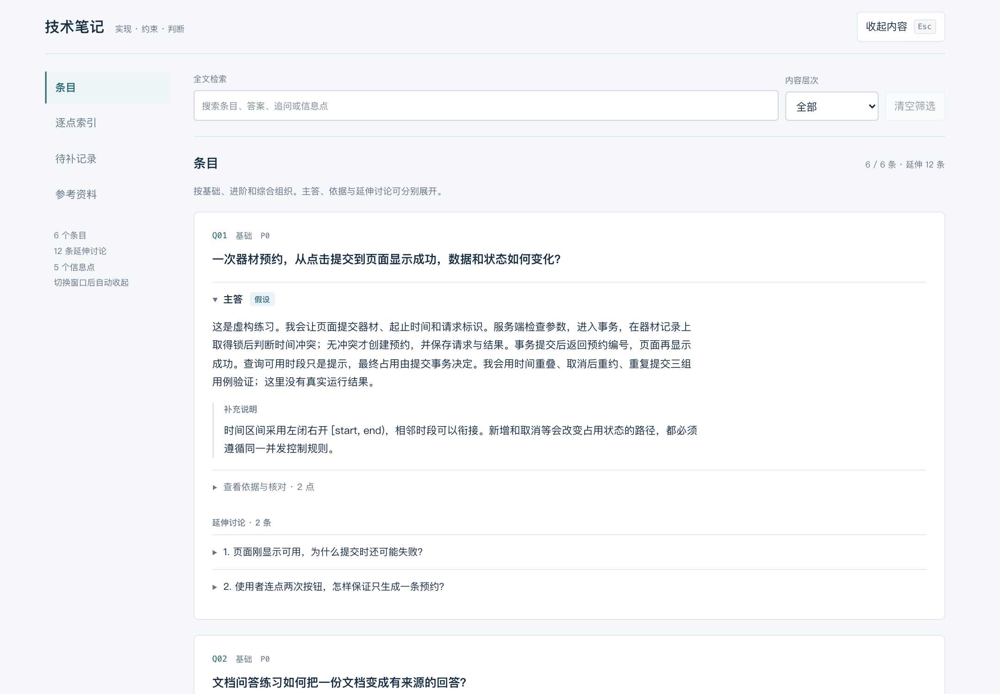
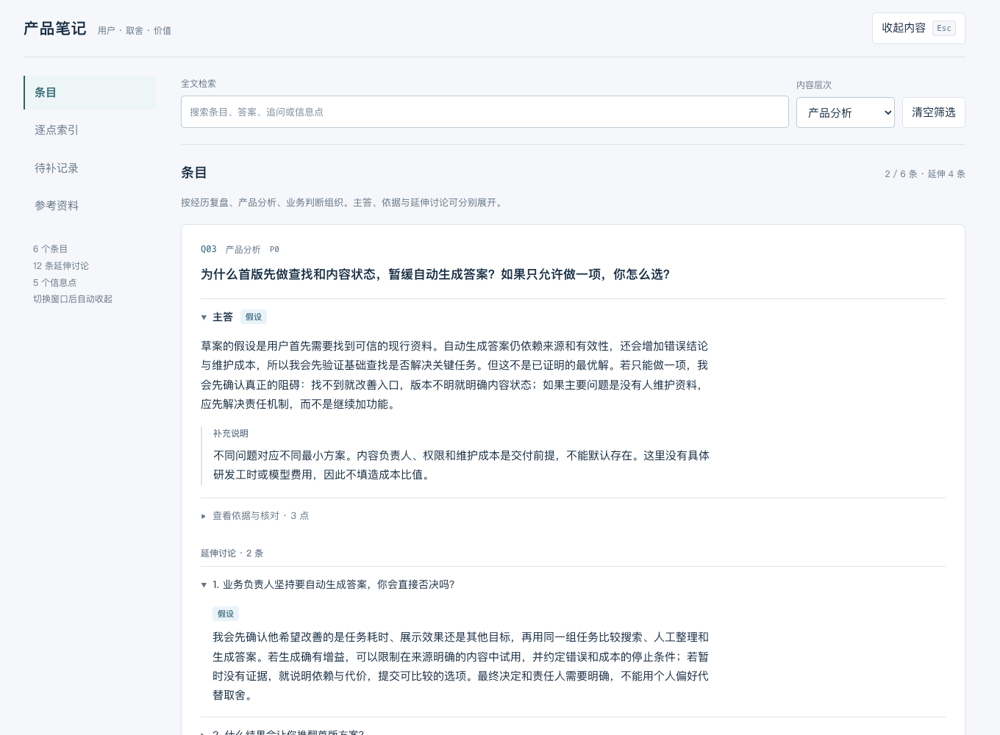
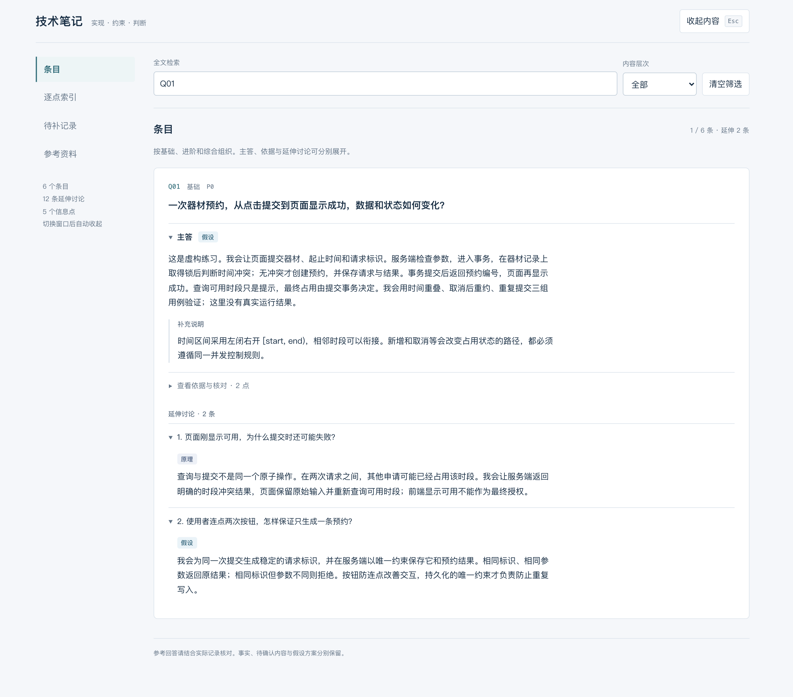
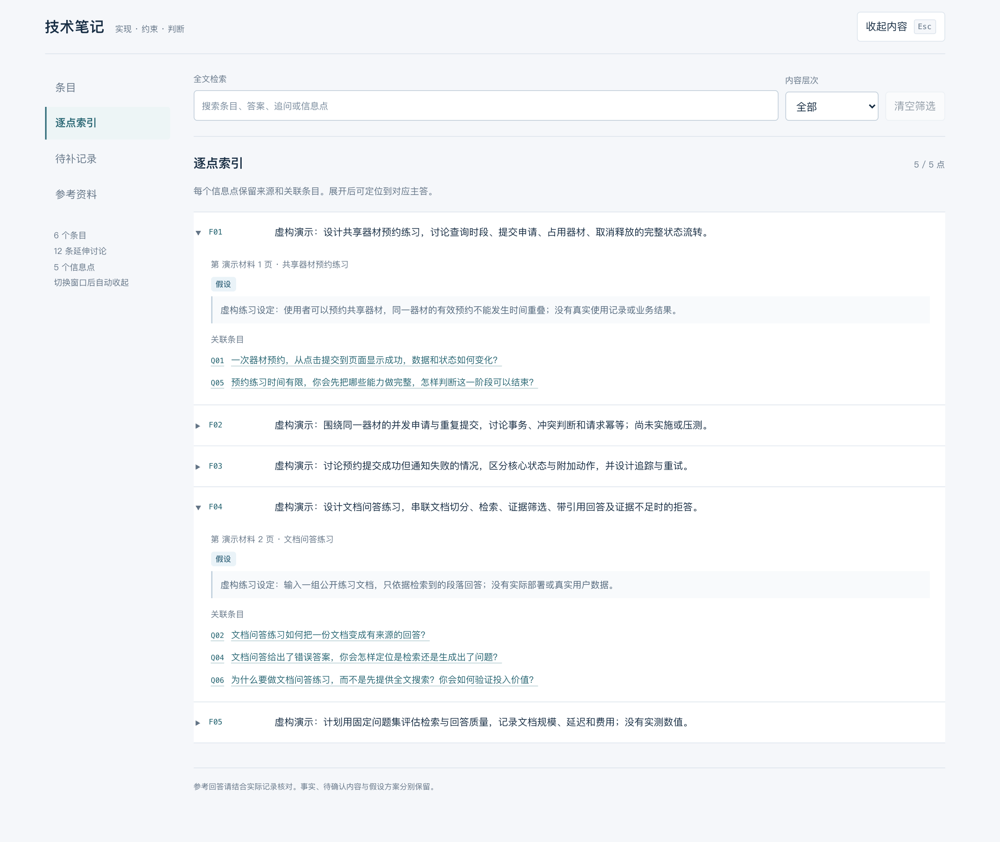
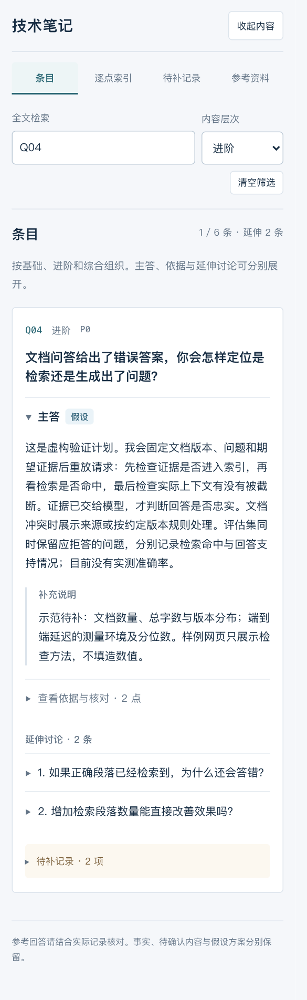

<h1 align="center">Resume Interview Drill</h1>

<p align="center"><strong>根据你的简历，生成各轮面试问题、追问和参考答案，并整理成可离线查看的网页。</strong></p>

<p align="center">
  <code>Agent Skill</code> · 技术岗位 / 产品经理 · <a href="LICENSE">MIT</a>
</p>

<p align="center">
  <a href="#quick-start">快速开始</a> ·
  <a href="#compatibility">支持平台</a> ·
  <a href="#features">主要功能</a> ·
  <a href="#tracks">岗位与效果图</a> ·
  <a href="#privacy">办公场景与隐私</a>
</p>

<a id="quick-start"></a>

## 快速开始

**1. 安装技能**

WorkBuddy：[下载 ZIP](https://github.com/sherlockmen/resume-interview-drill/archive/refs/heads/master.zip)，在“技能 → 添加技能 → 上传技能”中导入。

使用 Codex、Claude Code 等平台，在终端运行：

```sh
npx skills add sherlockmen/resume-interview-drill -g
```

需要 Node.js/npm 和 Git，按下表选择平台。

**2. 附上简历，说一句**

```text
使用 resume-interview-drill，帮我准备面试。
```

可补充岗位要求，或指定“技术岗位”“产品经理”。生成后，用浏览器打开网页即可练习。

<a id="compatibility"></a>

## 支持平台

| 平台 | 安装方式 | 调用方式 |
| --- | --- | --- |
| [WorkBuddy](https://www.codebuddy.cn/docs/workbuddy/From-Beginner-to-Expert-Guide/Function-Description/Skills-Market) | 上传技能包 | 上方指令 |
| [豆包工作（PC）](https://www.feishu.cn/content/article/7677519271848610746) | 本地技能导入，待验证 | 在“更多技能”中选择 |
| [TRAE 国内版](https://docs.trae.cn/ide_skills) | 安装器选 `trae-cn` | 上方指令 |
| [CodeBuddy Code](https://www.codebuddy.cn/docs/cli/skills) | 安装器选 `codebuddy` | 上方指令 |
| [Qwen Code](https://qwenlm.github.io/qwen-code-docs/en/users/features/skills/) | 安装器选 `qwen-code` | 上方指令 |
| [Kimi Code CLI](https://www.kimi.com/code/docs/en/kimi-code-cli/customization/skills.html) | 安装器选 `kimi-code-cli` | `/skill:resume-interview-drill` |
| [Codex](https://learn.chatgpt.com/docs/build-skills) | 安装器选 `codex` | `$resume-interview-drill` |
| [Claude Code](https://code.claude.com/docs/en/skills) | 安装器选 `claude-code` | `/resume-interview-drill` |
| [DeepSeek Harness](https://github.com/deepseek-ai/deepseek-harness/blob/master/packages/skill/skill-filesystem/README.md) | 安装器选 `codex`（共用目录） | `/resume-interview-drill` |
| [OpenCode](https://opencode.ai/docs/skills/) | 安装器选 `opencode` | 上方指令 |
| [Hermes Agent](https://hermes-agent.nousresearch.com/docs/user-guide/features/skills) | 安装器选 `hermes-agent` | `/resume-interview-drill` |

平台名链接到官方说明。已检查安装文件和网页生成，尚未逐个客户端实测。豆包工作文档未说明完整技能包格式，导入待验证；普通豆包聊天不在此列。

<details>
<summary><strong>运行要求与手动安装</strong></summary>

AI 工具需能读取材料、保存文件、运行 Python 3.9+。PDF 读取和网页预览使用平台自带工具；生成网页无需安装 Python 扩展库。

手动安装：解压上方 ZIP，将文件夹改名为 `resume-interview-drill`，放入对应目录：

| 平台 | 默认用户目录 |
| --- | --- |
| Codex / DeepSeek Harness / Kimi Code CLI | `~/.agents/skills/` |
| TRAE 国内版 | `~/.trae-cn/skills/` |
| CodeBuddy Code | `~/.codebuddy/skills/` |
| Qwen Code | `~/.qwen/skills/` |
| Claude Code | `~/.claude/skills/` |
| OpenCode | `~/.config/opencode/skills/` |
| Hermes Agent | `~/.hermes/skills/` |

请复制完整文件夹，保留脚本和模板。DeepSeek Harness 也支持 `~/.dsh/skills/`。安装后找不到技能时，新建会话。

</details>

<a id="features"></a>

## 主要功能

<table>
  <tr>
    <td width="50%" valign="top">
      <h3>01 · 简历每一项都问到</h3>
      项目、技能、成果等每一项内容，都对应具体问题和答案。
    </td>
    <td width="50%" valign="top">
      <h3>02 · 追问有答案</h3>
      每道题和每条追问都有参考答案，并说明为什么这样问。
    </td>
  </tr>
  <tr>
    <td width="50%" valign="top">
      <h3>03 · 不编造经历</h3>
      缺失的信息标记待补，假设的做法单独说明，不写成真实经历。
    </td>
    <td width="50%" valign="top">
      <h3>04 · 随时查阅和练习</h3>
      搜索问题、按轮次查看、展开答案，核对简历还有哪些内容需要补充。
    </td>
  </tr>
</table>

> **你会得到：** 各轮问答、简历与问题对照表、待补内容、准备顺序，以及离线网页。
> 可能的问法无法穷尽。

<a id="tracks"></a>

## 岗位与效果图

技术岗位和产品经理分别生成问答与网页。轮次可按实际流程调整。

<table>
  <tr>
    <td width="50%" valign="top">
      <h3>技术岗位</h3>
      <p>一面：项目怎么实现，自己做了什么。<br>
      二面：遇到故障、流量增长等情况，如何选方案。<br>
      负责人轮：业务价值是什么，先做什么，如何交付。</p>
      <a href="docs/images/overview.png"></a>
      <p><a href="docs/demo.html">演示文件</a> · <a href="references/technical-interviews.md">提问方法</a></p>
    </td>
    <td width="50%" valign="top">
      <h3>产品经理</h3>
      <p>一面：需求从哪里来，自己推动了什么。<br>
      二面：为什么先做它，如何衡量效果、确认变化原因。<br>
      负责人轮：为谁解决问题，投入是否值得，下一步做什么。</p>
      <a href="docs/images/product-overview.png"></a>
      <p><a href="docs/product-demo.html">演示文件</a> · <a href="references/product-manager-interviews.md">提问方法与来源</a></p>
    </td>
  </tr>
</table>

<sub>效果图均来自虚构示例。下载仓库后，用浏览器打开演示文件。</sub>

### 回答与简历对照

<table>
  <tr>
    <td width="50%" valign="top">
      <strong>查看回答与追问</strong><br><br>
      <a href="docs/images/answers.png"></a>
    </td>
    <td width="50%" valign="top">
      <strong>查看简历每一项对应的问题</strong><br><br>
      <a href="docs/images/coverage.png"></a>
    </td>
  </tr>
</table>

<details>
<summary><strong>手机效果</strong></summary>



</details>

<a id="privacy"></a>

## 办公场景与隐私

- **低调显示：** 使用“技术笔记”“产品笔记”等名称，替换指定词语，隐藏姓名和联系方式。
- **快速收起：** 默认显示封面；按 Esc、切换窗口或标签页时收起正文并清空搜索。
- **离线阅读：** 网页不加载外部资源，不保存阅读记录；默认保存在本地，不发布到网站。

收起正文不等于加密，拿到文件的人仍可查看内容。材料仍由你使用的 AI 工具分析。

<details>
<summary><strong>哪些内容会隐藏</strong></summary>

默认替换“简历、面试、求职、跳槽、招聘”，隐藏常见邮箱和连续 11 位的中国大陆手机号。姓名、其他联系方式及个人链接由 AI 识别后隐藏。交付前还会检查正文、源码、标题和文件路径。

</details>

<details>
<summary><strong>项目文件</strong></summary>

| 文件 | 用途 |
| --- | --- |
| [SKILL.md](SKILL.md) | 完整指令与完成标准 |
| [references/](references/) | 技术、产品与 Agent 岗位的提问方法 |
| [scripts/build_notes.py](scripts/build_notes.py) | 检查题库、隐藏敏感信息、生成网页 |
| [assets/notes.html](assets/notes.html) | 离线网页模板 |
| [docs/](docs/) | 虚构示例、演示页与截图 |
| [agents/openai.yaml](agents/openai.yaml) | Codex 中显示的技能名称与说明 |

修改题库或网页时，查看 [SKILL.md](SKILL.md#使用内置构建器)。

</details>

## 许可证

[MIT](LICENSE)。外部文章与指南保留各自权利。
